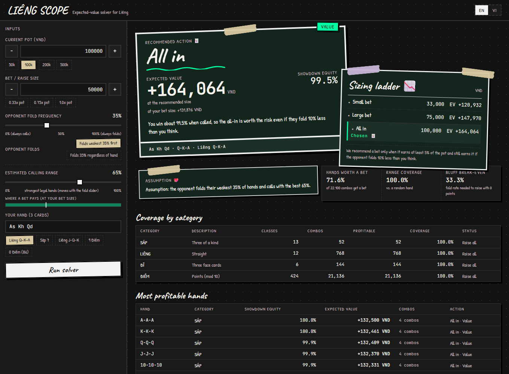

# Liêng Stealer · LIÊNG SCOPE

**An expected-value (EV) decision tool for _Liêng_, the Vietnamese three-card game.**
Given the pot, your bet, how often the opponent folds and your three cards, it recommends one of three
bet sizes (*Tố* or *Tất tay*) and shows the expected value behind it, for your hand and for all 22,100
possible hands at once.

It ships as a Python engine with a command-line tool, a Flask JSON API, and a bilingual (English /
Vietnamese) React web app called **LIÊNG SCOPE**.

`Python 3.11+` · `Flask 3` · `React 19 + Vite 8` · `267 backend + 37 frontend tests` · `MIT license`

---

## Contents

- [What it does](#what-it-does)
- [UI preview](#ui-preview)
- [Quick start](#quick-start)
- [How it works](#how-it-works)
- [Using it](#using-it): [web app](#web-app) · [command line](#command-line) · [HTTP API](#http-api)
- [Regenerating the data](#regenerating-the-data)
- [Project layout](#project-layout)
- [Testing](#testing)
- [Configuration and deployment](#configuration-and-deployment)
- [Limitations](#limitations)
- [Learning guide](#learning-guide)
- [Disclaimer and license](#disclaimer-and-license)

---

## What it does

- **Ranks every hand correctly.** Sáp > Liêng > Đĩ > Điểm, including the edge cases (A-2-3 is the lowest
  straight, Q-K-A the highest, K-A-2 is not a straight; any Đĩ beats 9 points).
- **Knows every hand's equity.** The win rate of all 455 hand types (all 22,100 hands, with suits
  ignored) against every possible opponent hand, computed **exactly** and stored in a small JSON file.
- **Models the opponent two ways.**
  - `range` (the default): the opponent folds their **weakest** hands first, so you are called only by
    stronger ones. Computed exactly, with card removal.
  - `random`: the opponent folds regardless of their cards, so a call comes from a uniformly random hand.
- **Recommends a size.** One of three wagers (a third of the pot, three quarters, the whole pot) with
  its EV, the win rate behind it, and the reason it won. Hands that earn nothing get a check instead.
- **Prices every fold estimate.** The choice must clear a 5%-of-pot floor at your fold rate and at the
  worst of ±10 points around it, so a bet that only works on your own guess is refused.
- **Scans the whole range.** How many of the 22,100 hands take each size in this spot, per category.
- **Answers instantly.** The slow work (≈ 10 s) runs once, offline; each question is a lookup plus a
  little arithmetic (≈ 1–2 ms for all 455 hand types).

---

## UI preview

The web app is a dark scrapbook board: the verdict is a pastel polaroid, the sizing ladder is a taped
sticky note, and the opponent assumption is a small scrap tucked underneath. Every number is set in
monospace so EV values line up down the ladder, while Value / Thin / Bluff are signalled by neon
emerald / amber / violet stamps. The paper tint follows the recommendation, and a check gets a neutral
sheet with no stamp.



---

## Quick start

You need **Python 3.11+**, **Node.js 22.22+** (required by Vite 8 and the Vitest/jsdom test stack) and npm.

**1. Backend** (Flask API on port 5000):

```bash
git clone https://github.com/kkdoestech/lieng-stealer.git
cd lieng-stealer/backend
python -m venv .venv
source .venv/bin/activate          # Windows PowerShell: .venv\Scripts\Activate.ps1
pip install -r requirements-dev.txt   # the API, the CLI, tests and linters (requirements.txt = server only)
python app.py
```

Check it: `curl -s http://127.0.0.1:5000/health` →
`{"classes_loaded":455,"database_loaded":true,"status":"healthy","version":"3.1.0"}`

**2. Frontend** (in a second terminal):

```bash
cd lieng-stealer/frontend
npm install
npm run dev
```

Open <http://localhost:5173>. The page solves the default spot on load: pot 100,000 VND, bet 50,000,
the opponent folds 35% of their weakest hands first, hand `As Kh Qd`. In development the page calls
`/api/...` on its own origin and Vite forwards those requests to the backend.

**Or use the command line only** (no frontend needed):

```bash
cd backend
python -m src.cli --pot 100000 --bet 50000 --fold-equity 0.35 --hand "As Kh Qd"
```

The precomputed data (`backend/data/winrates.json`) is committed, so nothing needs to be generated first.

---

## How it works

### 1. Hand ranking

Every 3-card hand falls into exactly one category; a higher category always wins.

| Category | What it is | Order inside the category |
| :--- | :--- | :--- |
| **Sáp** | Three of a kind | 2-2-2 < … < A-A-A |
| **Liêng** | Three consecutive ranks, any suits | A-2-3 < 2-3-4 < … < J-Q-K < Q-K-A. **K-A-2 is not a Liêng.** |
| **Đĩ** | Three face cards (J, Q, K) that aren't a Sáp or a Liêng | e.g. J-Q-Q, K-K-Q. **Beats every Điểm hand, even 9 points.** |
| **Điểm** | Everything else | Points = sum of card values mod 10 (2–9 = face value, 10/J/Q/K = 0, A = 1); 9 is best, 0 (*Bù*) is worst |

Ties inside a category are broken by the cards (this is a house-rule choice; tables differ): higher Sáp
rank, higher straight, Đĩ by highest then middle card, and equal Điểm scores by the highest card (Ace
high), then the remaining cards. `evaluate_hand` turns a hand into a comparable score tuple, so one `>`
decides any showdown.

### 2. From 22,100 hands to 455 hand types

Suits never decide a showdown, so hands that differ only in suits are equivalent. C(52, 3) = **22,100**
hands collapse into C(15, 3) = **455 canonical hand types** (rank multisets). Each type has a
*multiplicity*: the number of real hands it stands for.

| Category | Types | Real hands | Hands per type |
| :--- | ---: | ---: | :--- |
| Sáp | 13 | 52 | 4 |
| Liêng | 12 | 768 | 64 |
| Đĩ | 6 | 144 | 24 |
| Điểm | 424 | 21,136 | 4, 24 or 64 |
| **Total** | **455** | **22,100** | |

### 3. Equity: how often a hand wins when called

`opponent_model` picks one of two readings of the same assumption. Both take `fold_equity` as the share
of the time the opponent folds, and they differ in which hands do the folding.

- **`range` (the default).** The opponent folds the weakest *f* share of the 22,100 pre-deal hands and
  calls with the strongest *1 − f*. Folding works from the bottom up, so a call comes from a stronger
  hand than the average one. `CallingRangeModel` computes this exactly, including card removal (your
  cards can't be in the opponent's hand), using one prefix-sum table per hand type (built once in
  ≈ 50 ms). At *f* = 0 it reproduces `winrates.json` exactly.
- **`random` (only when you ask for it).** The opponent folds *f* of the time whatever they hold, so a
  call comes from a uniformly random hand. For each of the 455 types, remove its three cards from the
  deck and compare it with **every** possible opponent hand, all C(49, 3) = 18,424 of them. Equity =
  (wins + ½ ties) / 18,424. Those numbers are stored in `backend/data/winrates.json` (≈ 83 KB) and
  loaded into a dictionary at start-up for O(1) lookups.

The API, the CLI and the web page all default to `range`. To get the uniform model, send
`"opponent_model": "random"`.

The models disagree most about medium hands. At a 30% fold rate, `K-Q-3` (3 points) has equity
**8.19%** against the range model and **36.00%** against the uniform one. `9-8-4` has **0.00%** and
**10.89%**. Across all 455 classes, **370** differ by more than 5 equity points. At the web page's
default 35% fold rate the gap for `K-Q-3` is wider still, **1.08%** against the range and **36.00%**
against the uniform model.

`fold_equity` is the API's **single** opponent assumption. The calling range it implies,
`(1 − f) × 100%`, is reported back as `call_range_percent` (read-only, derived, and `null` under
`random`). The same engine powers the single-hand answer and the 455-class table, so one request has
exactly one equity per hand, and the verdict card and the table row cannot disagree.

### 4. From EV to a bet size

You bet *B* into a pot *P*. The opponent folds with probability *f*; if they call, you win the final pot
*P + 2B* with probability *e* (your equity):

```
EV = f × P  +  (1 − f) × (e × (P + 2B) − B)
```

- **EV prices one size, it does not pick one.** A bigger bet wins more when the opponent folds and loses
  more when they call and your hand is beaten, so every size has its own EV. Choosing between sizes is a
  comparison of those numbers, and the comparison has to survive a wrong fold estimate.
- **Pure-bluff break-even:** with *e* = 0, a bet pays when *f* > B / (P + B). For a 50,000 bet into
  100,000 that is **33.3%**. Above it, every hand is profitable at that size.
- **Under the `range` model, EV is not monotonic in *f*:** more folds also mean stronger callers. Example:
  `K-Q-3`, pot = bet = 100,000. That bet is +EV when the opponent folds **0% to 8%** (weak hands still
  call) or **51% to 100%** (folds alone pay for the bet), and −EV in between. The tool therefore reports
  every profitable **zone** of fold frequencies, scanned on a 1% grid, and reports EV in the centre cell
  and in the two cells ten points either side.

### 5. The advice: three rungs, one floor, three bands

The ladder is set by the pot alone: **33%** of the pot (the small rung), **75%** (the large rung) and
**100%** (all in, labelled "All in (whole pot)"). There is no stack input, so the whole pot is the price
ceiling of the model. `bet_size` still decides the reported `ev` and the fold-zone scan, and it does not
move the ladder.

The policy walks down, never up:

1. **Label the hand from its win rate when called.** **VALUE** at 55% and above, **THIN** from 45% to
   55%, **BLUFF** below 45%. The label never gates value sizing.
2. **Start at the biggest rung the win rate allows.** All in when the win rate is at least 85%, the large
   rung when it is above 50%, the small rung otherwise.
3. **Step down until a rung passes both tests.** Its EV must be at least **5% of the pot** in the centre
   fold cell **and** in the worst of the two stress cells at your fold rate minus and plus ten points.
   None of the three passes, and the answer is a check.
4. **A bluff may only use the small rung.** Large and all-in rungs never become eligible for a bluff,
   whatever their EV says.

That answers a different question from "is EV above zero". A bet that earns 2% of the pot is positive and
still not worth the variance, and a bet that earns 12% at your fold rate can lose money when the opponent
folds ten points less often than you guessed. The 5% floor and the worst cell are what make the answer
hold up under a wrong estimate of *f*. All in earns its own gate, an 85% win rate, because it risks the
largest amount.

**Why a fixed fold rate makes this a policy rather than an EV maximum.** The tool uses one fold rate for
every size, so it does not model the fact that real players fold more to a big bet than to a small one.
Without that elasticity, EV keeps rising with the size whenever your hand wins at showdown, and a plain
argmax would shove almost every strong hand. Three rules take its place: the bands, the 85% all-in gate,
and the cap that keeps bluffs small. The trade-off is stated plainly in [Limitations](#limitations): the
fold rate that applies is the one for the size chosen, and you supply it.

**The guarantee, in one sentence:** *it only recommends a bet that earns at least 5% of the pot at your
fold rate and at the worst fold rate within ten points of it, and it steps down or checks when that
fails.*

---

## Using it

### Web app

Inputs on the left, results on the right.

- **Inputs:** pot and bet (with −/+ steppers and presets such as *100k* or *0.33x pot*), the opponent's
  fold frequency (slider), how the opponent folds (**Folds weakest 35% first** = `range`, the default;
  **Folds 35% regardless of hand** = `random`), and your hand (e.g. `As Kh Qd`, or one of the presets).
  The calling-range slider is a second view of the same assumption: it shows the strongest
  `(1 − f) × 100%` of hands and moving it moves the fold frequency, so the page always sends the API one
  opponent assumption.
- **Results:** the recommendation (action, kind and amount) with the ladder and the reason behind it; a
  line naming the assumption in the response's own numbers (*the opponent folds their weakest 35% of
  hands and calls with the best 65%*); *where raising pays*, a bar showing the profitable fold ranges
  with a marker at your current estimate; range coverage, showdown equity, EV and bluff break-even;
  coverage by category; the most profitable hands; and optional **analysis notes** (see
  [`/api/analyze`](#http-api)). Clearing the hand keeps the range tables on screen and says so.
- **EN / VI** switch in the header; the choice is remembered in the browser. Numbers follow the language
  (`131,876` in English, `131.876` in Vietnamese).

The visual rules (colours, type, layout, copy) are in [`DESIGN.md`](DESIGN.md).

### Command line

From `backend/`:

```bash
python -m src.cli --pot 100000 --bet 100000 --fold-equity 0.35 --hand "Ks Qh 3d"
```

It prints the game state, a range summary, a per-category table and the advice for your hand:

```
╭──────────────────────────────────── HAND EVALUATION & ACTION ────────────────────────────────────╮
│ Hand Evaluated: Ks Qh 3d (3 điểm)                                                                │
│ Canonical Class: K-Q-3 (Điểm)                                                                    │
│ Showdown Equity: 1.08%                                                                           │
│ Expected Value (EV) at 100,000: -27,894                                                          │
│ Break-Even Fold Equity: n/a (range model)                                                        │
│                                                                                                  │
│  >>> ACTION: SMALL BET (33,000) — BLUFF <<<                                                      │
│ Why: Small bluff: EV is +14,715.32 but the win rate is low (1.08%), so risk the least that still │
│ buys the fold.                                                                                   │
│ Ladder (SMALL_BLUFF):                                                                            │
│   ✓ SMALL BET     33,000  EV +   14,715.32  worst +14.72% of pot  <- recommended                 │
│   ✗ LARGE BET     75,000  EV      -11,995  worst -12.00% of pot  blocked: EV_BELOW_FLOOR         │
│   ✗ ALL IN       100,000  EV      -27,894  worst -27.89% of pot  blocked: EV_BELOW_FLOOR         │
╰──────────────────────────────────────────────────────────────────────────────────────────────────╯
```

| Option | Meaning | Default |
| :--- | :--- | :--- |
| `--pot` | Pot before your bet (VND) | 100000 |
| `--bet` | Your bet / raise | 50000 |
| `--fold-equity` (alias `--p-fold`) | Opponent fold probability, 0–1 | 0.35 |
| `--hand` | Your hand, e.g. `"As Kh Qd"` or `"As,Kh,Qd"` | none (range report only) |
| `--opponent-model` | `range` or `random` | `range` |
| `--db` | Path to the win-rate file | `backend/data/winrates.json`, wherever you run from |

Run it with no options (or only `--opponent-model`, which becomes the default answer) for an
**interactive** session. Every input is checked before anything is printed. Exit codes: **0** success,
**1** the win-rate file can't be loaded (or the solver's model is broken), **2** invalid input (`Invalid input: …` on stderr), **130** Ctrl-C.

**Card notation** (CLI and API): rank `2`–`10` (or `T`), `J`, `Q`, `K`, `A`, followed by a suit `s` `c`
`d` `h` (or `♠ ♣ ♦ ♥`); upper or lower case. Separate cards with spaces, commas or hyphens.

### HTTP API

Base URL `http://127.0.0.1:5000`. Requests and responses are JSON. Browsers may call the API only from the
origins in `CORS_ORIGINS` (by default the Vite dev server; see [Configuration](#configuration-and-deployment)).

| Method | Path | Purpose |
| :--- | :--- | :--- |
| `GET` | `/` | Service info and the list of endpoints |
| `GET` | `/health` | Status and number of hand types loaded |
| `POST` | `/api/solve` | Full range scan plus optional advice for one hand (used by the web app) |
| `POST` | `/api/evaluate` | Advice for one hand (`hand` required) |
| `POST` | `/api/range` | Range scan only |
| `POST` | `/api/analyze` | Strategy notes in Vietnamese from an LLM, or a rule-based text when no API key is set. Rate-limited per client (default 10 per minute) |

**Common request fields** for the `POST` endpoints:

| Field | Type | Default | Rule |
| :--- | :--- | :--- | :--- |
| `pot` | number | 100000 | > 0 |
| `bet_size` (`bet` is still accepted) | number | 50000 | > 0 |
| `fold_equity` | number | 0.35 | 0–1; the single opponent assumption. Under `range` it also fixes the calling range, `(1 − f) × 100%` |
| `opponent_model` | `"range"` \| `"random"` | `"range"` | `"range"` folds the weakest hands first, `"random"` folds regardless of hand strength. The web page sends `"range"` |
| `hand` | string | — | optional for `/api/solve`, required for `/api/evaluate` |

The body must be a JSON object, and numbers must be real, finite numbers (`"nan"`, `"inf"` and `true` are
rejected). Missing fields take the defaults above.

**Changed in 3.1.0:** the default `opponent_model` is now `"range"`. A client or command that omitted the
field and relied on the old uniform numbers must send `"opponent_model": "random"` (API) or
`--opponent-model random` (CLI). The old and new answers differ for most medium hands, as the K-Q-3 and
9-8-4 numbers in [How it works](#3-equity-how-often-a-hand-wins-when-called) show.

**Removed in 2.0.0:** `call_range_percent`. It encoded the same opponent assumption as `fold_equity`
(a caller holding the strongest 30% folds 70% of the time), so sending both let one answer be computed
from one value and the table from the other. The API now rejects it with `400` and tells the caller to
send `fold_equity = 1 - call_range_percent / 100`.

**Errors.** Every error, including unknown URLs, is JSON with a stable `code`:
`{"error": "A Liêng hand cannot have duplicate cards.", "code": "invalid_hand"}`.

| `code` | Status | When |
| :--- | :--- | :--- |
| `invalid_params` | 400 | A body that isn't valid JSON or isn't an object, a bad number, an unknown `opponent_model`, the removed `call_range_percent` field, a missing `hand` on `/api/evaluate` |
| `invalid_hand` | 400 | The hand text isn't three valid, different cards |
| `not_found` / `method_not_allowed` | 404 / 405 | Unknown URL / wrong HTTP method |
| `rate_limited` | 429 | Too many `/api/analyze` calls (the `Retry-After` header says when to try again) |
| `upstream_error` | 502 | The LLM service failed or sent something unexpected (details are logged, not returned) |
| `internal_error` | 500 | A bug; the server logs the traceback |

**One vocabulary.** The three solver endpoints use the same field names with the same meanings:
`bet_size`, `showdown_equity` (equity when called, under the chosen model), `advice` (the one
recommendation for the hand), `is_profitable` (EV at `bet_size` above zero). The single-hand answer is
the matching row of the 455-class table, so `showdown_equity`, `ev` and `advice` are identical in both
places for the same hand. `call_range_percent` is a derived readout of the fold frequency (`null` under
`random`), and `sensitivity` stresses that one assumption by ±10 percentage points, reporting the calling
range each cell implies.

**Removed in 3.0.0:** `decision` (`"RAISE"` / `"CHECK/FOLD"`) and `recommended_action` (`"BET"` /
`"NO BET"`). A boolean verdict cannot say how much to bet, so both are replaced by `advice`, in
`hand_evaluation` and in every `top_hands` row. Each row carries `action`, `kind` and `amount` now.

**No hand is not an error.** A cleared or absent `hand` on `/api/solve` or `/api/analyze` returns
`200` with `hand_evaluation: null` plus the full range. Only `/api/evaluate` requires a hand.

**Single-hand fields.**

| Field | Meaning |
| :--- | :--- |
| `advice` | The recommendation. Fields below. |
| `showdown_equity` | Equity used by the chosen model; `equity_vs_random` is always included for comparison |
| `ev` | EV of `bet_size`, which is not necessarily the recommended size |
| `is_profitable` | `ev` > 0, kept from 2.0.0 |
| `call_range_percent` | The calling range implied by `fold_equity`, `(1 − f) × 100`; `null` under `random` |
| `sensitivity` | Three stress cells (`f ∓ 0.10`), each reporting its EV, equity and implied calling range, plus `ROBUST_BET` / `ROBUST_NO_BET` / `ASSUMPTION_SENSITIVE` |
| `break_even_fold_equity` | Exact fold frequency where EV = 0 (`random` model). `null` under `range`, where no single break-even exists |
| `profitable_from_fold_equity` | First fold frequency (1% grid) from which raising stays +EV up to 100% |
| `profitable_fold_zones` | Every `[start, end]` interval where raising is +EV |

**The advice object.**

| Field | Meaning |
| :--- | :--- |
| `action` | `CHECK`, `SMALL_BET`, `LARGE_BET` or `ALL_IN` |
| `kind` | `VALUE` at 55% win rate and above, `THIN_VALUE` from 45% to 55%, `BLUFF` below 45% |
| `reason` | Which rule fired: `CHECK_NO_EDGE`, `CHECK_EDGE_TOO_SMALL`, `CHECK_ASSUMPTION_FRAGILE`, `SMALL_BLUFF`, `SMALL_THIN`, `SMALL_VALUE`, `LARGE_THIN`, `LARGE_VALUE`, `ALL_IN_VALUE` |
| `amount` | The wager in VND; `0.0` for a check. The ladder comes from the pot, so `bet_size` never moves it |
| `ev`, `ev_ratio` | EV of the recommended action and that EV as a share of the pot; both `0.0` for a check |
| `equity_when_called` | Win rate when called, in the centre fold cell |
| `win_rate_defined` | `false` when the fold rate left the calling range empty. Say nobody calls instead of showing 0% |
| `robust` | The worst stress cell of the chosen rung does not lose money |
| `why` | `fold_component` (`f × pot`), `call_component` and `net`, all at the chosen rung |
| `ladder` | The three rungs, small then large then all in. Rows below |

**One ladder row.**

| Field | Meaning |
| :--- | :--- |
| `action`, `amount` | The rung and its wager |
| `ev`, `ev_ratio` | EV in the centre fold cell, and as a share of the pot |
| `worst_ev_ratio` | The worst of the stress cells, as a share of the pot |
| `robust` | `worst_ev_ratio` is not negative |
| `eligible` | This rung may be the answer |
| `blocked_by` | Why it may not: `EV_BELOW_FLOOR`, `NEEDS_BIGGER_EDGE`, `BLUFF_TOO_SMALL_ONLY`, or `null` when eligible |

**Summary fields added in 3.0.0.** `summary` keeps every field it had, including
`range_coverage_percent`, and adds:

| Field | Meaning |
| :--- | :--- |
| `action_counts` | How many of the 455 classes take each action: `CHECK`, `SMALL_BET`, `LARGE_BET`, `ALL_IN` |
| `bet_recommended_percent` | Share of the 22,100 hands that get any bet, weighted by multiplicity |
| `bet_ladder` | The three wagers in VND: `[33000.0, 75000.0, 100000.0]` for a pot of 100,000 |
| `sizing` | The effective thresholds (`small_fraction`, `large_fraction`, `all_in_fraction`, `min_edge_ratio`, `all_in_min_equity`, `large_min_equity`, `value_equity_floor`, `bluff_equity_ceiling`, `fold_step`) plus `all_in_size`. Read these instead of hard-coding a number |

`sizing.fold_step` is how far the stress cells reach either side of your fold rate. The rule behind these
numbers is in [How it works](#5-the-advice-three-rungs-one-floor-three-bands).

#### Example: `POST /api/solve`

```bash
curl -s -X POST http://127.0.0.1:5000/api/solve -H "Content-Type: application/json" \
  -d '{"pot": 100000, "bet_size": 100000, "fold_equity": 0.35, "hand": "Ks Qh 3d", "opponent_model": "range"}'
```

Response (shortened: `top_hands` has 30 entries and `category_breakdown` has 4). This is the Flask test
client's own output for that body, pasted unchanged:

```json
{
  "hand_evaluation": {
    "advice": {
      "action": "SMALL_BET",
      "amount": 33000.0,
      "equity_when_called": 0.0108,
      "ev": 14715.32,
      "ev_ratio": 0.14715319999999998,
      "kind": "BLUFF",
      "ladder": [
        {"action": "SMALL_BET", "amount": 33000.0, "blocked_by": null, "eligible": true, "ev": 14715.32, "ev_ratio": 0.14715319999999998, "robust": true, "worst_ev_ratio": 0.14715319999999998},
        {"action": "LARGE_BET", "amount": 75000.0, "blocked_by": "EV_BELOW_FLOOR", "eligible": false, "ev": -11995.0, "ev_ratio": -0.11995, "robust": false, "worst_ev_ratio": -0.11995},
        {"action": "ALL_IN", "amount": 100000.0, "blocked_by": "EV_BELOW_FLOOR", "eligible": false, "ev": -27894.0, "ev_ratio": -0.27894, "robust": false, "worst_ev_ratio": -0.27894}
      ],
      "reason": "SMALL_BLUFF",
      "robust": true,
      "why": {"call_component": -20284.68, "fold_component": 35000.0, "net": 14715.32},
      "win_rate_defined": true
    },
    "break_even_fold_equity": null,
    "call_range_percent": 65.0,
    "canonical_id": "K-Q-3",
    "category": "DIEM",
    "category_name": "Điểm",
    "equity_vs_random": 0.3599924,
    "ev": -27894.0,
    "hand": "Ks Qh 3d",
    "is_profitable": false,
    "profitable_fold_zones": [[0.0, 0.08], [0.51, 1.0]],
    "profitable_from_fold_equity": 0.51,
    "random_hand_equity": 0.3599924,
    "score_name": "3 điểm",
    "sensitivity": {
      "call_range_percent_range": [55.0, 75.0],
      "central_equity_when_called": 0.0108,
      "fold_equity_range": [0.25, 0.45],
      "scenarios": [
        {"call_range_percent": 75.0, "equity_when_called": 0.142, "ev": -18050.000000000007, "fold_equity": 0.25},
        {"call_range_percent": 65.0, "equity_when_called": 0.0108, "ev": -27894.0, "fold_equity": 0.35},
        {"call_range_percent": 55.0, "equity_when_called": 0.0, "ev": -10000.000000000007, "fold_equity": 0.45}
      ],
      "status": "ROBUST_NO_BET"
    },
    "showdown_equity": 0.0108
  },
  "summary": {
    "action_counts": {"ALL_IN": 54, "CHECK": 128, "LARGE_BET": 98, "SMALL_BET": 175},
    "bet_ladder": [33000.0, 75000.0, 100000.0],
    "bet_recommended_percent": 71.62,
    "bet_size": 100000.0,
    "call_range_percent": 65.0,
    "category_breakdown": [
      {"category": "SAP", "classes": 13, "combos": 52, "profitable_combos": 52}
    ],
    "final_pot": 300000.0,
    "fold_equity": 0.35,
    "highest_ev_hand": "A-A-A",
    "highest_ev_value": 165000.0,
    "opponent_model": "range",
    "pot": 100000.0,
    "profitable_classes": 250,
    "profitable_combinations": 12060,
    "pure_bluff_break_even_fold_equity": 0.5,
    "range_coverage_percent": 54.57,
    "sizing": {
      "all_in_fraction": 1.0,
      "all_in_min_equity": 0.85,
      "all_in_size": 100000.0,
      "bluff_equity_ceiling": 0.45,
      "fold_step": 0.1,
      "large_fraction": 0.75,
      "large_min_equity": 0.5,
      "min_edge_ratio": 0.05,
      "small_fraction": 0.33,
      "value_equity_floor": 0.55
    },
    "threshold_ev_value": 420.0,
    "threshold_hand": "K-Q-4",
    "total_canonical_classes": 455,
    "total_combinations": 22100
  },
  "top_hands": [
    {"action": "ALL_IN", "amount": 100000.0, "canonical_id": "A-A-A", "category": "SAP", "ev": 165000.0, "kind": "VALUE", "multiplicity": 4, "showdown_equity": 1.0}
  ]
}
```

Read this response in four steps. Your hand is a bluff with 1.08% equity when called, so only the small
rung can be the answer. The small rung earns 14,715.32, which is 14.72% of the pot in the centre cell and
in the worst cell, so it clears the 5% floor. The large and all-in rungs lose money in the centre cell,
so both are blocked with `EV_BELOW_FLOOR`. The answer is 33,000 into 100,000.

`threshold_hand` is the profitable hand type with the lowest EV (the last one before EV turns negative).
It is still the EV of `bet_size`, not of the recommended size.

#### Example: `POST /api/evaluate`

```bash
curl -s -X POST http://127.0.0.1:5000/api/evaluate -H "Content-Type: application/json" \
  -d '{"pot": 100000, "bet_size": 50000, "fold_equity": 0.35, "hand": "As Kh Qd"}'
```

The game parameters plus exactly the `hand_evaluation` fields of `/api/solve`. The request omits
`opponent_model`, so it runs on the default `range` model. This is the Flask test client's own output for
that body, pasted unchanged except for `sensitivity`, cut to keep it short:

```json
{
  "advice": {
    "action": "ALL_IN",
    "amount": 100000.0,
    "equity_when_called": 0.9952,
    "ev": 164064.0,
    "ev_ratio": 1.64064,
    "kind": "VALUE",
    "ladder": [
      {"action": "SMALL_BET", "amount": 33000.0, "blocked_by": null, "eligible": true, "ev": 120932.07999999999, "ev_ratio": 1.2093208, "robust": true, "worst_ev_ratio": 1.1763872},
      {"action": "LARGE_BET", "amount": 75000.0, "blocked_by": null, "eligible": true, "ev": 147970.0, "ev_ratio": 1.4797, "robust": true, "worst_ev_ratio": 1.4048},
      {"action": "ALL_IN", "amount": 100000.0, "blocked_by": null, "eligible": true, "ev": 164064.0, "ev_ratio": 1.64064, "robust": true, "worst_ev_ratio": 1.54076}
    ],
    "reason": "ALL_IN_VALUE",
    "robust": true,
    "why": {"call_component": 129064.0, "fold_component": 35000.0, "net": 164064.0},
    "win_rate_defined": true
  },
  "bet_size": 50000.0,
  "break_even_fold_equity": null,
  "call_range_percent": 65.0,
  "canonical_id": "Q-K-A",
  "category": "LIENG",
  "category_name": "Liêng",
  "equity_vs_random": 0.99693335,
  "ev": 131876.0,
  "fold_equity": 0.35,
  "hand": "As Kh Qd",
  "is_profitable": true,
  "opponent_model": "range",
  "pot": 100000.0,
  "profitable_fold_zones": [[0.0, 1.0]],
  "profitable_from_fold_equity": 0.0,
  "random_hand_equity": 0.99693335,
  "score_name": "Liêng Q-K-A",
  "showdown_equity": 0.9952
}
```

Q-K-A wins 99.52% of showdowns against the strongest 65% of hands, which is `showdown_equity` here, and
99.69% against a random hand, which is `equity_vs_random`. All three rungs clear the floor, so the
answer is the largest one. The two EV fields differ on purpose: `ev` is the EV of the `bet_size` you
sent (50,000), `advice.ev` is the EV of the size the policy recommends (100,000).

`/api/range` returns the same fields as the `/api/solve` `summary` (including `category_breakdown`) plus
`top_hands`, in the same shape as above. `/api/analyze` takes the same fields as `/api/solve` (with an
optional `hand`), recomputes every number on the server, and returns `{"advice": "...", "model": "..."}`;
anything else in the body, such as a client-side `hand_evaluation`, is ignored. In that one response
`advice` is the notes text, and the notes quote the action, the kind, the amount and the why.

---

## Regenerating the data

`backend/data/winrates.json` is committed. To rebuild it (from `backend/`):

```bash
python -m src.generator                 # exact enumeration (default): ≈ 10 s on one core
python -m src.generator --monte-carlo --samples 10000 --output data/winrates_mc.json
```

Exact enumeration is deterministic: the regenerated file is byte-for-byte identical to the committed one.
Monte Carlo is only for experiments; the tests expect the exact data. Other options: `--output` (default
`backend/data/winrates.json`, wherever you run from), `--workers` (default: number of CPU cores; use
`--workers 1` on a busy machine). The file is written atomically, so an interrupted run never leaves a
half-written database, and the loader rejects files that don't describe all 455 hand types.

---

## Project layout

```
lieng-stealer/
├── backend/
│   ├── app.py                  Flask API (validation, opponent models, LLM notes)
│   ├── Procfile                gunicorn start command for hosting platforms
│   ├── requirements.txt        runtime: Flask, flask-cors, Flask-Limiter, gunicorn, requests
│   ├── requirements-dev.txt    + pytest, rich (CLI), ruff, mypy
│   ├── pyproject.toml          ruff, mypy (strict) and pytest settings
│   ├── .env.example            every environment variable the API reads
│   ├── data/winrates.json      precomputed equity of all 455 hand types (exact)
│   ├── src/
│   │   ├── exceptions.py       LiengError hierarchy
│   │   ├── paths.py            default data path (independent of the current directory)
│   │   ├── evaluator.py        Card, Hand, HandScore, evaluate_hand (ranking rules)
│   │   ├── hands.py            22,100 hands → 455 canonical types, multiplicities
│   │   ├── generator.py        equity generator (exact or Monte Carlo, multi-process)
│   │   ├── db.py               WinRateDB: loads winrates.json for O(1) lookups
│   │   ├── calling_range.py    OpponentModel, CallingRangeModel (equity vs a calling range)
│   │   ├── ev.py               EV, break-even fold equity, profitable fold zones
│   │   ├── advice.py           the three-rung ladder, the 5% floor and the value/thin/bluff bands
│   │   ├── range_finder.py     the request's one equity source, EV of all 455 types, advice, sorting, coverage
│   │   ├── sensitivity.py      the fold-rate assumption stress grid behind `sensitivity`
│   │   └── cli.py              command-line interface
│   └── tests/                  pytest suite (267 tests)
├── frontend/
│   ├── index.html, vite.config.js, package.json, .oxlintrc.json
│   └── src/
│       ├── main.jsx, App.jsx   the web app
│       ├── solve-contract.json the UI's default request + expected numbers, read by both test suites
│       ├── i18n.js             English and Vietnamese UI text
│       ├── format.js           money and fold-zone formatting
│       ├── index.css, App.css  colour tokens and layout
│       └── *.test.js(x)        Vitest tests (37 tests)
├── .github/workflows/ci.yml    CI: backend, frontend and course checks on every push
├── learning/                   guided tour of the codebase: 18 lessons, start at COURSE.md
├── AGENTS.md                   engineering spec: rules, data model, maths, performance budgets
├── DESIGN.md                   web UI spec
├── SKILLS.md                   command cheat-sheet
├── BLOG.md, EXPERIMENT.md      project write-up and report (Vietnamese)
└── LICENSE
```

---

## Testing

From the repository root:

```bash
(cd backend && python -m pytest -q)                          # 267 collected; 2 fail on Windows only
(cd backend && ruff check . && mypy)                         # lint + strict type check: 0 issues
(cd frontend && npm test)                                    # 37 passed (Vitest, 3 files)
(cd frontend && npm run lint && npm run build)               # 0 warnings; production build in dist/
python3 learning/verify_course.py                            # the course still matches the code
```

GitHub Actions runs the same checks on every push (`.github/workflows/ci.yml`). Timing tests scale their
budgets by `PERF_BUDGET_FACTOR` (CI sets 3, because shared runners are slower).

| Test file | Tests | Covers |
| :--- | ---: | :--- |
| `test_evaluator.py` | 27 | Card parsing, category order, straight edge cases, Đĩ rules, points mod 10, tie-break house rules, hashing, the 1 µs budget |
| `test_hands.py` | 8 | 455 types, multiplicities summing to 22,100, suit invariance, duplicate cards, ordering |
| `test_exceptions.py` | 9 | The exception hierarchy callers rely on |
| `test_generator.py` | 15 | Exact equities, rate invariants, Monte Carlo convergence, data-file schema, CLI flags, atomic write, file permissions, private RNG |
| `test_db.py` | 13 | Loading, lookup latency, error handling, validation of malformed or incomplete files |
| `test_calling_range.py` | 13 | Card removal, exact match with `winrates.json` at 0% folds, monotonicity, one implementation for single queries and the full table, latency, model invariants |
| `test_ev.py` | 19 | EV boundaries, bluffing, break-even, profitable fold zones, strong hands, non-finite inputs |
| `test_advice.py` | 32 | Threshold ordering, the fold grid, the three rungs, the 5% floor in the centre and worst cell, the value/thin/bluff band edges, bluffs capped at the small rung, the all-in gate, nobody calling |
| `test_range_finder.py` | 28 | Range scan, coverage, opponent models, tie ordering, one answer per hand (identity), the fold cells and their centre column, category breakdown |
| `test_cli.py` | 16 | The ladder in the report and its markers, checks that quote the best refused rung, interactive mode, exit codes, validation before output, plain-text fallback |
| `test_api.py` | 81 | Every endpoint, both models, one answer per hand, the advice block, injected thresholds and `sizing`, the removed fields, blank hands, JSON errors, `/api/analyze` (OpenRouter mocked), rate limit and `Retry-After`, proxy handling, CORS, settings |
| `test_dynamic_scenarios.py` | 6 | End-to-end player stories (value raise, junk fold, pure bluff, coverage sweep, both models) |
| frontend `App.test.jsx` | 31 | Rendering, the shared contract body, the linked sliders, the blank-hand range view, error messages, stale results cleared, language toggle, steppers, request cancelling, the recommendation and its ladder, the assumption line |
| frontend `format.test.js`, `i18n.test.js` | 6 | Locale-aware money formatting, zone formatting, EN/VI dictionary parity |

The tests never call the internet: the LLM calls are mocked or use the offline fallback.

---

## Configuration and deployment

All backend variables are listed in [`backend/.env.example`](backend/.env.example); every one is optional.

| Variable | Used by | Purpose |
| :--- | :--- | :--- |
| `OPENROUTER_API_KEY` | backend | Enables LLM notes in `/api/analyze`. Without it, a rule-based text is returned. |
| `OPENROUTER_MODEL`, `OPENROUTER_TIMEOUT` | backend | LLM model (default `meta-llama/llama-3.1-8b-instruct:free`) and timeout in seconds (default 15) |
| `CORS_ORIGINS` | backend | Comma-separated browser origins allowed to call the API (default `http://localhost:5173,http://127.0.0.1:5173`). Set it to your frontend's URL in production. |
| `ANALYZE_RATE_LIMIT`, `RATELIMIT_STORAGE_URI` | backend | Per-client limit for `/api/analyze` (default `10 per minute`) and where counts live (default `memory://`, which counts per worker; use e.g. `redis://…` for one shared limit) |
| `RATELIMIT_ENABLED` | backend | `false` turns the limiter off (default `true`; test apps turn it off themselves) |
| `PROXY_FIX_X_FOR` | backend | How many reverse proxies to trust for `X-Forwarded-For` (default `0`). Behind a hosting proxy set it to `1`, or every visitor shares one rate-limit budget. |
| `HOST`, `PORT` | backend | Address for `python app.py` (default `127.0.0.1:5000`; `HOST=0.0.0.0` shares it on your network). The `Procfile` uses `$PORT`. |
| `VITE_API_URL` | frontend, **at build time** | Backend URL. Without it the page calls `/api` on its own origin. It ends up in the public JavaScript bundle, so never put secrets in it. |

`.env` files are git-ignored, so real keys stay out of the repository. Nothing loads `.env` automatically:
export the variables in your shell (for example `set -a; . backend/.env; set +a`) or set them in your
hosting platform's settings.

| Part | Example platform | Build | Run |
| :--- | :--- | :--- | :--- |
| Backend | Render, Railway | `pip install -r requirements.txt` | `gunicorn app:app --bind 0.0.0.0:$PORT --workers 2 --worker-class gthread --threads 4 --timeout 60 --preload` (from `backend/Procfile`) |
| Frontend | Vercel, Netlify | `npm run build` with `VITE_API_URL` set | serve `frontend/dist/` as static files |

---

## Limitations

- **EV, not an equilibrium.** The tool computes the expected value of one bet at each of three sizes,
  under the assumptions you give it. It does not solve for a game-theory-optimal strategy.
- **One betting round, two players:** the opponent can only fold or call; no re-raises, no multi-way pots.
- **The fold frequency is your estimate.** The default `range` model also assumes the opponent folds
  strictly from the weakest hand up. Real players fold a mix of hands, so the answer is only as good as
  the `fold_equity` you send.
- **Tie-breaking rules** follow one common convention (see [Hand ranking](#1-hand-ranking)); house rules vary.
- **Profitable zones are on a 1% grid**, so a zone boundary can differ from the exact value by up to one
  point (e.g. 0.51 instead of 0.50).

### Deliberate limits of the advice model

These are choices, not bugs. Each one would need a new input to change.

- **No stack.** There is no stack field, so all in means the whole pot, and 100% of `pot` is the price
  ceiling of the model. A short stack, or an opponent who covers less than the pot, needs a `stack`
  input and a cap on every rung.
- **One fold rate, applied at the size chosen.** The fold rate is a single number. Real players fold more
  to a big bet than to a small one, and that elasticity is not modelled. The 5% floor in the worst stress
  cell stands in for it. If you think the opponent folds less often to the larger rungs, lower
  `fold_equity` and run it again.
- **A bet into dead money, not a raise over a live bet.** The EV formula prices a bet of *B* into a pot
  *P* that the opponent then calls with *B*. That fits Liêng's open bet, and it is not the same sum as
  raising over a live wager, where the pot already holds someone else's bet and the amount to call is
  fixed.

---

## Learning guide

[`learning/COURSE.md`](learning/COURSE.md) is a guided tour of this codebase: 18 lessons that walk through
every file, from the card evaluator to the React page, explaining what each piece does and why, with
runnable examples, exercises and quizzes. `python3 learning/verify_course.py` checks that the lessons still
match the code.

---

## Disclaimer and license

This project is for learning computer science, probability and software engineering. It is not a
gambling service, does not handle real money, and must not be used in breach of any law or any
platform's terms of service.

Released under the [MIT License](LICENSE).
